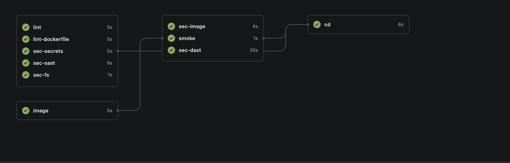

# Frontend (React + Vite) — CI/CD

[](http://localhost:3000/cquynt/frontend/actions?workflow=ci.yml)

Badge xanh `success` = lint + quét bảo mật + build + deploy thành công; đỏ `failure` = có bước hỏng. Bấm vào badge để xem log từng bước. Badge chỉ hiển thị khi Gitea chạy ở `localhost:3000`.

## Kết quả build thành công



## Image đã build

Image chạy non-root (uid 65534), nghe cổng `8080`, base `busybox:stable-musl`, chỉ phục vụ file tĩnh từ `vite build`. Mỗi lần CI xanh trên `main`, image được push lên registry local `localhost:5001`, tag theo 7 ký tự đầu của commit và `latest`:

```
$ docker images localhost:5001/frontend
REPOSITORY                TAG       SIZE
localhost:5001/frontend   latest    1.9MB
localhost:5001/frontend   bb1cf47   1.9MB
```

Xem danh sách hiện tại: `curl -s http://localhost:5001/v2/frontend/tags/list`

## Pipeline (`.github/workflows/ci.yml`)

| Giai đoạn | Job |
|---|---|
| 1 (song song) | `lint` (oxlint), `image` (build), `lint-dockerfile` (hadolint), `sec-secrets` (gitleaks), `sec-sast` (semgrep), `sec-fs` (trivy fs) |
| 2 (cần `image`) | `sec-image` (trivy), `smoke`, `sec-dast` (OWASP ZAP) |
| CD (chỉ `main`, khi tất cả xanh) | push → ký cosign → SBOM CycloneDX → verify chữ ký + SBOM → deploy theo digest → kiểm tra app |

Push chỉ sửa `*.md` / `docs/**` không chạy lại CI.

## Chạy local

```bash
npm ci
npm run dev       # http://localhost:5173
npm run lint
npm run build

docker compose up # dev, http://localhost:3000 (Dockerfile.dev)
docker build -t frontend . && docker run --rm -p 8080:8080 frontend
```

## Secrets cần có (Gitea → Settings → Actions → Secrets)

- `COSIGN_PRIVATE_KEY`
- `COSIGN_PASSWORD`

Public key để verify: [cosign.pub](cosign.pub).

## Kiểm tra thủ công

```bash
# chữ ký
cosign verify --key cosign.pub --insecure-ignore-tlog --allow-insecure-registry --allow-http-registry \
  localhost:5001/frontend:latest

# SBOM
cosign verify-attestation --key cosign.pub --type cyclonedx --insecure-ignore-tlog \
  --allow-insecure-registry --allow-http-registry localhost:5001/frontend:latest

# app đang chạy
curl http://localhost:8082/
```
